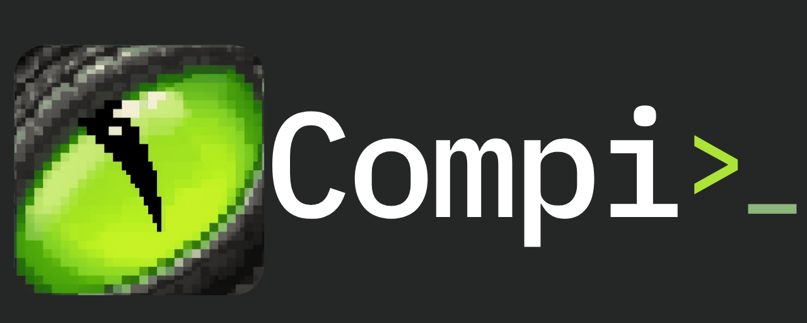
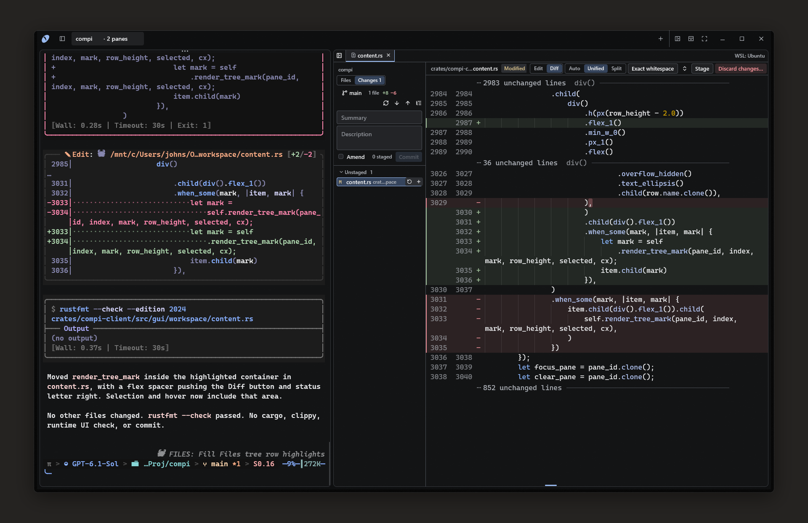

# Compi

**The terminal you can live in.**

Shells that keep running when you close the window, with an editor, diffs and Git beside them. Native on Windows (WSL2) and macOS.

[](https://github.com/cloudboy-jh/compi/actions/workflows/core-ci.yml)



## Terminal

- Shells live in a background server: close the window, rebuild the client or reconnect over SSH, and they are still running.
- Workspaces, tabs and split panes. Drag a pane to move it, swap it or send it to another tab. Float any pane.
- Layout presets, prompt styles from Oh My Posh or Starship, themes and fonts.

## Edit

- Open files beside the terminal that's using them: `compi edit src/main.rs:42`, Ctrl-click a path in any output, or the command palette.
- A native code editor with syntax highlighting and search. Saves never overwrite changes made outside it, and unsaved edits survive a crash.

## Review

- Every uncommitted change, unstaged and staged, side by side or inline, with the changed words highlighted.
- One tab per file: switch between Edit and Diff with Ctrl+Shift+D and stay on the same line.
- Git marks in the editor's gutter as you type. Jump between changes with Alt+F5, or open a change from the terminal with `compi diff path:line`.

## Commit

- Stage files or single hunks, write the message, commit or amend.
- See how far you are ahead or behind, switch or create branches, and fetch, pull or push in a terminal beside the editor, so logins just work.

## Built for scripts and agents

The `compi` command opens panes, sends input, reads output, and opens files and diffs, so an agent can drive the same workspace you're looking at.

## Download

Get Compi from [GitHub Releases](https://github.com/cloudboy-jh/compi/releases).

- **Windows:** x64, WSL2 required. Installer or portable archive.
- **macOS:** Apple Silicon, macOS 14+. Move the app into Applications.

Windows builds are unsigned and macOS builds are ad-hoc signed, so your OS may warn on first launch. Linux runs the headless server; its window is not yet supported.

## Development

Requires Rust and platform build tools. Windows also needs WSL2 and PowerShell 7; macOS needs Xcode with the Metal compiler.

```bash
pwsh -File tools/prepare-conpty.ps1   # Windows only, once
cargo dev                             # isolated preview that rebuilds on save
cargo test --locked -p compi-protocol -p compi-daemon -p compi-client -p compi-dev
```

Shells in the preview survive client rebuilds. See the [development guide](docs/dev/DEVELOPMENT.md).

## Documentation

- Users: [installation](docs/user/INSTALLATION.md), [usage](docs/user/USAGE.md), [configuration](docs/user/CONFIGURATION.md), [release notes](docs/user/release-notes.md)
- Developers: [development](docs/dev/DEVELOPMENT.md), [architecture](docs/dev/Spec.md), [next steps](docs/dev/NEXT_STEPS.md), [verification history](docs/dev/COMPLETED.md), [distribution](docs/dev/DISTRIBUTION.md), [release flow](docs/dev/RELEASE-FLOW.md), [terminal test recipes](docs/dev/testcmds.md)

## License

[MIT](LICENSE). Copyright (c) 2026 Jack Horton.
